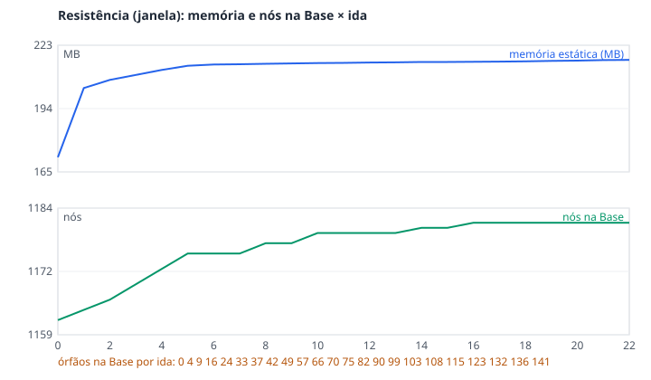
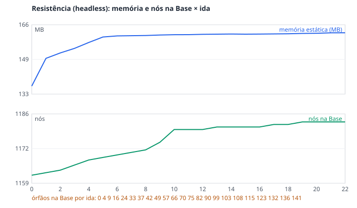
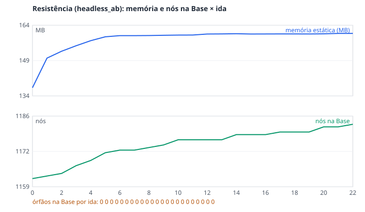

# Relatório de QA por bot (#126)

Rodada de 2026-10-19 sobre `main` 940bf0b + correções deste lote. Máquina: RTX 4060, Godot 4.3
(build de debug do editor), janela 1920x1080, vsync desligado e sem limite de FPS (configuração
salva do jogador). Os números vêm de `tools/bot/qa_report.py`.

## Como repetir

```bash
G=/c/Godot/Godot_v4.3-stable_win64_console.exe
python tools/bot/qa_gen.py              # gera tools/bot/qa_*.json
bash tools/bot/run_qa.sh "$G"           # todos (≈ 10 min); guarda e repõe o user://
bash tools/bot/run_qa.sh "$G" tools/bot/qa_geleira.json   # só um
```

Saída: `.bot_runs/qa_logs/<roteiro>.log` (log do Godot), `.bot_runs/qa_<roteiro>_<data>/` (dumps e
capturas) e `.bot_runs/qa_logs/report.md` (tabela).

Cada `qa_<mapa>.json` parte da Base com tudo liberado, vai ao mapa de dia (~20 s andando com o
`explore`, um dump de FPS a cada ~2 s), força o clima do mapa (onde houver) e anda mais ~10 s, volta
à Base, repete à noite (onde houver) e faz uma 3.ª ida curta. Os órfãos
(`Performance.OBJECT_ORPHAN_NODE_COUNT`) são lidos antes, no fim de cada cena e de volta à Base.

## Mapas

FPS: média / mínimo das amostras de 1 s (`Engine.get_frames_per_second()`), sem a 1.ª amostra
(carregamento). "à saída" = avisos do Godot ao fechar (vazamentos de RID/ObjectDB, todos causados
pelos órfãos de #128).

| mapa | fase | SCRIPT ERROR | erros | warnings | órfãos lobby → fim da cena → lobby | FPS méd / mín |
|---|---|---|---|---|---|---|
| Praia | dia | 0 | 54 (#127) | 0 (+36 à saída) | 0 → 4 → 4 | 579 / 554 |
| Praia | dia + chuva | 〃 | 〃 | 〃 | (mesma ida) | 568 / 548 |
| Praia | noite | 〃 | 〃 | 〃 | 4 → 8 → 8 | 568 / 542 |
| Praia | 3.ª ida | | | | 12 → 12 | |
| Campo | dia | 0 | 72 (#127) | 0 (+42 à saída) | 0 → 5 → 5 | 533 / 511 |
| Campo | dia + chuva | 〃 | 〃 | 〃 | (mesma ida) | 522 / 504 |
| Campo | noite | 〃 | 〃 | 〃 | 5 → 10 → 10 | 528 / 516 |
| Campo | 3.ª ida | | | | 15 → 15 | |
| Ruínas | dia (sem clima) | 0 | 42 (#127) | 0 (+54 à saída) | 0 → 7 → 7 | 579 / 568 |
| Ruínas | noite | 〃 | 〃 | 〃 | 7 → 14 → 14 | 574 / 546 |
| Ruínas | 3.ª ida | | | | 21 → 21 | |
| Geleira | dia | 0 | 45 (#127) | 75 (#129) (+60 à saída) | 0 → 8 → 8 | 594 / 564 |
| Geleira | dia + nevasca | 〃 | 〃 | 〃 | (mesma ida) | 598 / 573 |
| Geleira | noite | 〃 | 〃 | 〃 | 8 → 16 → 16 | 604 / 575 |
| Geleira | 3.ª ida | | | | 24 → 24 | |
| Cratera | dia | 0 | 63 (#127) | 0 (+66 à saída) | 0 → 9 → 9 | 596 / 573 |
| Cratera | dia + cinzas | 〃 | 〃 | 〃 | (mesma ida) | 585 / 579 |
| Cratera | noite | 〃 | 〃 | 〃 | 9 → 18 → 18 | 601 / 585 |
| Cratera | 3.ª ida | | | | 27 → 27 | |
| Ilha do Tesouro | dia (sem noite/clima) | 0 | 2 (#127) | 0 (+48 à saída) | 0 → 9 → 9 | 664 / 648 |
| Ilha do Tesouro | 2.ª ida | | | | 18 → 18 | |

Leitura:
- **Nenhum SCRIPT ERROR** em nenhum mapa, fase ou tela.
- **Pior FPS:** Campo com chuva, 504 mín (522 méd). Nada perto de 60 nesta máquina.
- **Vazamento:** os órfãos sobem um degrau fixo por mapa carregado (Praia 4, Campo 5, Ruínas 7,
  Geleira 8, Cratera 9, Ilha 9) e nunca descem. São as caixas de `ShopOffer` (#128). Fora isso a
  contagem fica estável (não há crescimento dentro da cena, nem com clima ou noite).
- **Erros:** todos são `Lambda capture at index 0 was freed` (#127). Crescem a cada ida (18 na 2.ª,
  36 na 3.ª na Praia).

## Telas

| tela | roteiro | resultado |
|---|---|---|
| Lobby / Base: Loja, Museu, Expedições, Diário, Mapa do Tesouro + Ver museu e volta à tenda | `qa_base.json` | OK: 0 erros, 0 warnings, 0 órfãos |
| Pausa: no lobby (Configurações → Voltar → Continuar) e na Praia (abrir/fechar, Voltar à base, resumo) | `qa_pause.json` | OK: 0 erros; 4 órfãos = a ida à Praia (#128) |
| Título + slots: Novo jogo → Slot 1, Sair para o menu → Continuar, Carregar → Slot 1, Apagar → Confirmar | `qa_title_slots.json` | OK: 0 erros, 0 órfãos; slot apagado volta a "Vazio" |
| Vitória: abrir, Créditos, fechar | `qa_victory.json` | OK: 0 erros, 0 órfãos |

## Issues dev-a abertas

- #127: `HostSync.on_peer_ready` (`gameplay/net/host_sync.gd`) nunca desliga a lambda do
  `peer_scene_ready` → `ERROR: Lambda capture at index 0 was freed`, acumulando a cada ida.
- #128: `ShopOffer` (`items/shop_offer.gd`) cria a caixa mesmo quando usa o `world_scene` → 1 nó
  órfão por oferta, a cada mapa carregado (+ vazamentos de RID à saída).
- #129: Geleira usa `specular` (nome do Godot 3) em `frozen_lake.gd` e `ice_floe.gd` → 75 warnings
  por run e o brilho do gelo não se aplica (no Godot 4 é `metallic_specular`).

As três foram corrigidas pelo Dev B no S2 (#145, edição mínima autorizada; ver "Resistência →
Correções aplicadas"). Ficam abertas até o Felipe confirmar.

## Correções Dev B

- `fix(core)`: `--resolution` da linha de comando volta a valer sobre a janela salva.
  `OS.get_cmdline_args()` não traz os argumentos do motor, então a tela cheia salva era aplicada por
  cima do `--resolution` dos bots e capturas (a 1.ª rodada deste QA saiu em 2560x1440).
- `feat(tools)`: o bot pode testar a tela inicial (`--bot-keep-title`) e escolher a janela
  (`BOT_RESOLUTION`).
- `feat(tools)`: roteiros `qa_*`, `run_qa.sh` e `qa_report.py`. Edição mínima no
  `debug_bridge.gd` (Dev A): dumps com `orphans`/`nodes` e `call` com `toggle`/`open`/`close`.

## Limites desta rodada

- A vitória foi aberta pelo `CoreVictoryScreen.open` (não derrotando o Colosso); o fluxo do chefe final
  já tem os testes `core/tests/net_victory_*`.
- O FPS é da build de debug numa RTX 4060 sem limite; serve para comparar mapas, não como mínimo
  de hardware.
- A coluna "erros/warnings" é por run do mapa (dia + noite + 3.ª ida juntos).

## N4: otimizações Dev B (#132)

O N1 não achou órfão nem vazamento em `core/` ou `ui/` (telas: 0 órfãos; os degraus por mapa são o
`ShopOffer`, #128, e os erros são o `HostSync`, #127, ambos Dev A). Do lado Dev B sobrou só custo
por frame à toa:

- `NightFx` processava todo frame, mesmo de dia, e à noite varria o grupo do jogador local a cada
  frame; `WeatherFx` processava todo frame mesmo sem clima. Agora só processam ativas, e a
  `NightFx` guarda o jogador. Microbenchmark (GUT headless, 20 000 chamadas): busca do jogador
  0,62 → 0,26 µs/frame; `_process` noturno inteiro 1,59 → 1,53 µs/frame; de dia e sem clima, 2
  chamadas de script a menos por frame.

Antes → depois no jogo, `qa_campo.json` (pior FPS do N1), duas rodadas de cada, alternadas,
mesma máquina e configuração do N1. FPS méd / mín:

| fase | antes (1) | antes (2) | depois (1) | depois (2) | órfãos (todas) |
|---|---|---|---|---|---|
| dia | 528 / 518 | 530 / 507 | 523 / 498 | 527 / 500 | 0 → 5 → 5 |
| dia + chuva | 531 / 520 | 518 / 506 | 531 / 526 | 525 / 512 | (mesma ida) |
| noite | 533 / 502 | 534 / 497 | 544 / 513 | 537 / 501 | 5 → 10 → 10 |
| 3.ª ida | | | | | 15 → 15 |

Leitura: a diferença fica dentro do ruído entre rodadas (±10 FPS). A cena é limitada pela
renderização, não pelos scripts do Dev B, e os órfãos/erros seguem iguais até #127/#128. Não há
mais nada do Dev B a cortar sem mudar o visual (as partículas de clima são `CPUParticles3D` com
400 gotas; passar para GPU fica para quando houver queda real de FPS em máquina fraca).

## Navegação por teclado e comando (P3, #135)

Rodada de 2026-10-19, janela 1920x1080. Os roteiros `qa_nav_keyboard.json` e `qa_nav_pad.json`
(gerados por `qa_gen.py`) começam no título com os slots vazios, passam por slots, configurações (as 4
abas, trocadas com Ctrl+Tab / RB), entram no lobby pelo Multiplayer (menu de rede visível), percorrem as
5 abas da Base, Ver museu, pausa (cartão, confirmar sair, configurações), vitória e créditos, uma ida à
Praia com o resumo do dia, e voltam ao título para os slots com save e o apagar. Só eventos de teclado
(`InputEventKey`) ou de comando (`InputEventJoypadButton`), entregues pelo `Input` como os de verdade.

```bash
bash tools/bot/run_qa.sh "$G" tools/bot/qa_nav_keyboard.json tools/bot/qa_nav_pad.json
```

Cada tela: foco inicial dentro dela, busca em largura no grafo de foco (setas + Tab/Shift+Tab no
teclado; só o direcional no comando) a partir do foco inicial, borda de foco presente (StyleBox `focus`,
`tab_focus` ou a linha selecionada do ItemList) e, nas camadas, B/Esc fecha e o foco cai em algo visível.
O resultado vai para `nav_<tela>.json` e para o `summary.json` (lista de alcançados × existentes,
armadilhas, controles sem borda e o resultado do B/Esc). Botões desativados não contam no total (e cair
num deles é armadilha). As abas Diário e Mapa do Tesouro não têm controles: o foco fica na barra de abas.

| tela | teclado | comando | armadilhas | Esc/B ok |
|---|---|---|---|---|
| título | 5/5 | 5/5 | 0 | — |
| slots (vazios) | 4/4 | 4/4 | 0 | ok |
| configurações: Vídeo | 9/9 | 9/9 | 0 | — |
| configurações: Áudio | 6/6 | 6/6 | 0 | — |
| configurações: Controles | 59/59 | 59/59 | 0 | — |
| configurações: Jogabilidade | 15/15 | 15/15 | 0 | ok |
| menu Multiplayer (lobby coop) | 5/5 | 5/5 | 0 | — |
| Base: Loja | 2/2 | 2/2 | 0 | — |
| Base: Museu | 5/5 | 5/5 | 0 | — |
| Base: Expedições | 3/3 | 3/3 | 0 | — |
| Base: Diário | 0/0 | 0/0 | 0 | — |
| Base: Mapa do Tesouro (pergaminho) | 0/0 | 0/0 | 0 | — |
| Ver museu | 1/1 | 1/1 | 0 | ok |
| pausa | 4/4 | 4/4 | 0 | — |
| pausa: confirmar sair | 2/2 | 2/2 | 0 | ok |
| pausa: configurações | 9/9 | 9/9 | 0 | ok |
| pausa (fechar) | 4/4 | 4/4 | 0 | ok |
| vitória | 2/2 | 2/2 | 0 | — |
| créditos | 1/1 | 1/1 | 0 | ok |
| vitória (fechar) | 2/2 | 2/2 | 0 | ok |
| resumo do dia | 2/2 | 2/2 | 0 | ok |
| slots (com save) | 5/5 | 5/5 | 0 | — |
| apagar slot | 2/2 | 2/2 | 0 | ok |

Passos novos do bot (edição mínima no `debug_bridge.gd`, Dev A): `{"ui_nav": "ui_down", "device":
"pad"}` (ui_up/down/left/right/accept/cancel, ui_focus_next/prev, tab_next/prev) e `{"nav_audit":
"<tela>", "root": "<nó>", "devices": [...], "allow_leave": bool, "cancel": "<nó>"}`. A lógica fica em
`ui/ui_nav_audit.gd` (UiNavAudit), usada também pelos testes.

Achados e correções Dev B (antes das correções: resumo do dia 0/2 sem foco nem B/Esc, menu coop 4/5 com
4 armadilhas, Vídeo em tela cheia e Loja sem saldo com foco em botão desativado, Diário/Mapa sem foco):

- Base: aba sem controles foca a barra de abas (esquerda/direita trocam de aba) em vez de deixar o
  foco na aba oculta (`UiFocus.focus_tab_page`); botões desativados (Comprar sem saldo, Partir/Desbloquear
  bloqueados) saem da navegação e voltam quando ativam (`UiFocus.skip_disabled`).
- Menu Multiplayer: a corrente de foco é refeita a cada troca de foco e de estado dos botões (o "Novo
  jogo" que aparece depois ficava fora; o "Entrar" desativado sem código era armadilha) e inclui a barra
  Online / Rede local.
- Configurações: a Resolução desativada (tela cheia) sai da navegação.
- Resumo do dia, aviso de queda do host e confirmação de sair: foco no botão ao abrir, anel só dentro do
  painel, B/Esc fecha e o foco volta ao de antes (ou à Base). O lobby carregando atrás do resumo não
  rouba mais o foco dele (`UiFocus.modal_open`).
- Pausa e vitória devolvem o foco ao fechar (antes o comando ficava sem foco nenhum na Base).

Testes: `tests/dev_b/test_nav_audit.gd` (cada tela nos dois dispositivos, B/Esc por camada, captura de
tecla cancelada por Esc/B sem fechar as configurações, toasts que não roubam o foco, painéis da sessão,
botões desativados e o resumo com o lobby atrás).

Limites: a confirmação de sair da sessão e o aviso de queda do host só aparecem com rede; ficam nos
testes GUT (sem rede nova no bot). O B/Esc no título, na Base e no menu de rede não fecha nada (são a
camada de baixo; na Base o Esc abre a pausa).


## Resistência (R5, #142)

Rodada de 2026-10-19 sobre `main` eb47350, mesma máquina do N1 (RTX 4060, build de debug, vsync
desligado). `tools/bot/soak_20.json` (gerado por `soak_gen.py`) faz **22 idas seguidas** pela Base,
rodando Praia → Campo → Ruínas → Geleira → Cratera (a Ilha fica de fora), alternando dia/noite e com
clima forçado em 1 ida de cada 3 (onde houver). Cada ida: apanha o detetor, cava e apanha até ter 2
achados (≤ 30 s), vende no SellPoint, volta à Base e fecha o resumo. Um dump no fim da cena (FPS
médio e mínimo da ida em janelas de 1 s, tempo de carga) e outro já na Base (memória e contagens: é
o patamar comparável entre idas).

```bash
G=/c/Godot/Godot_v4.3-stable_win64_console.exe
python tools/bot/soak_gen.py                         # [idas], padrão 22
bash tools/bot/run_soak.sh "$G"                      # janela 1920x1080, ≈ 13 min
bash tools/bot/run_soak.sh "$G" --headless           # só memória/nós, ≈ 11 min
```

Saída: `.bot_runs/soak_20_<data>/`, `.bot_runs/soak_logs/soak_20_<janela|headless>.log` e
`report_<rótulo>.md`; gráfico em `docs/qa/soak_<rótulo>.svg`. Edição mínima no `debug_bridge.gd`
(Dev A): os dumps ganham `perf` (`MEMORY_STATIC`, `OBJECT_COUNT`, `OBJECT_RESOURCE_COUNT`, FPS
méd/mín desde a última expedição e `load_s` = pedido de expedição → mapa pronto).

### Janela 1920x1080

| ida | mapa / fase | carga (s) | FPS méd | FPS mín | memória (MB) | objetos | nós | órfãos | recursos | dinheiro |
|---:|---|---:|---:|---:|---:|---:|---:|---:|---:|---:|
| 0 | Base (início) | — | — | — | 172.1 | 4388 | 1162 | 0 | 297 | 5000 |
| 1 | praia dia | 1.06 | 514 | 217 | 203.8 | 4755 | 1164 | 4 | 473 | 5002 |
| 2 | campo noite | 1.22 | 485 | 459 | 207.5 | 4841 | 1166 | 9 | 521 | 5089 |
| 3 | ruinas dia | 1.14 | 520 | 444 | 209.8 | 4918 | 1169 | 16 | 549 | 5430 |
| 4 | geleira noite | 1.33 | 510 | 437 | 212.1 | 4997 | 1172 | 24 | 584 | 5929 |
| 5 | cratera dia | 1.33 | 533 | 467 | 214.0 | 5075 | 1175 | 33 | 613 | 6925 |
| 6 | praia noite clima | 0.76 | 523 | 482 | 214.6 | 5092 | 1175 | 37 | 615 | 6933 |
| 7 | campo dia | 1.06 | 510 | 444 | 214.7 | 5111 | 1175 | 42 | 619 | 6987 |
| 8 | ruinas noite | 1.00 | 521 | 490 | 214.9 | 5146 | 1177 | 49 | 623 | 7485 |
| 9 | geleira dia clima | 1.06 | 489 | 406 | 215.1 | 5174 | 1177 | 57 | 625 | 8249 |
| 10 | cratera noite | 1.14 | 509 | 439 | 215.3 | 5209 | 1179 | 66 | 627 | 8893 |
| 11 | praia dia | 1.04 | 505 | 203 | 215.3 | 5222 | 1179 | 70 | 627 | 8901 |
| 12 | campo noite clima | 1.36 | 476 | 411 | 215.5 | 5239 | 1179 | 75 | 629 | 8955 |
| 13 | ruinas dia | 1.27 | 542 | 496 | 215.6 | 5260 | 1179 | 82 | 629 | 9425 |
| 14 | geleira noite | 1.36 | 508 | 421 | 215.8 | 5286 | 1180 | 90 | 629 | 10422 |
| 15 | cratera dia clima | 1.41 | 538 | 491 | 215.8 | 5322 | 1180 | 99 | 634 | 10422 |
| 16 | praia noite | 1.33 | 480 | 213 | 215.9 | 5339 | 1181 | 103 | 634 | 10428 |
| 17 | campo dia | 1.64 | 508 | 473 | 215.9 | 5355 | 1181 | 108 | 634 | 10598 |
| 18 | ruinas noite | 1.56 | 508 | 451 | 216.0 | 5376 | 1181 | 115 | 634 | 11279 |
| 19 | geleira dia | 1.63 | 527 | 423 | 216.2 | 5402 | 1181 | 123 | 636 | 12375 |
| 20 | cratera noite | 1.70 | 518 | 473 | 216.4 | 5428 | 1181 | 132 | 638 | 12694 |
| 21 | praia dia clima | 1.61 | 472 | 189 | 216.7 | 5448 | 1181 | 136 | 638 | 12709 |



22 idas. Base início → ida 5 (todos os mapas já visitados) → fim; ritmo por ida depois da ida 5:
- memória 172.1 → 214.0 → 216.7 MB (+0.16 MB/ida)
- objetos 4388 → 5075 → 5463 (+22.8/ida)
- nós 1162 → 1175 → 1181 (+0.4/ida)
- órfãos 0 → 33 → 141 (+6.4/ida)
- recursos 297 → 613 → 638 (+1.5/ida)
- FPS médio por ida 472–542; mínimo (janela de 1 s) 189
- carga 0.76–1.93 s (média 1.32 s)

### Headless e A/B com as correções do Dev A

Headless (mesmo roteiro, renderer dummy: o FPS não vale) e depois com as correções sugeridas em
#127 e #128 aplicadas **só localmente** (não entram neste lote; os arquivos são do Felipe):

| | memória ida 5 → 22 | objetos/ida | nós/ida | órfãos ida 22 | carga (1.ª volta → última) | `Lambda capture` no log |
|---|---|---|---|---|---|---|
| headless (main) | 159.9 → 161.8 MB | +22.9 | +0.8 | 141 | 1.21–1.62 s → 1.79–2.16 s | 4263 |
| headless + #127/#128 corrigidos | 159.1 → 160.5 MB | +4.9 | +0.6 | 0 | 1.19–1.39 s → 0.74–0.96 s | 0 |




### Conclusão

- **Sem vazamento do Dev B.** Depois da 1.ª volta pelos 5 mapas (caches, shaders e recursos de
  cada mapa carregados uma vez), o que ainda cresce por ida vem de dois lugares:
  1. **#128 (`ShopOffer`)**: +4/+5/+7/+8/+9 nós órfãos por Praia/Campo/Ruínas/Geleira/Cratera
     (`Node.print_orphan_nodes()`: só `MeshInstance3D`), 141 em 22 idas, ≈ 3 objetos por órfão
     (nó + `BoxMesh` + material). Com a correção sugerida: 0 órfãos e objetos +22,9 → +4,9/ida.
  2. **#127 (`HostSync.on_peer_ready`)**: as ligações ao `CoreSession.peer_scene_ready` sobem ≈ 19
     por ida (1 → 135 em 7 idas) e cada nova expedição chama todas as lambdas mortas: 4263
     `Lambda capture ... was freed` em 22 idas e o **tempo de carga sobe** de ≈ 1,0–1,4 s para
     1,6–2,2 s. Com a correção: carga estável (0,7–1,0 s a partir da 2.ª volta) e 0 erros.
- O resto (+0,6 nó e ≈ +5 objetos por ida, +0,1 MB/ida) são as peças novas do Museu na Base: cada
  achado novo que entra no Museu troca o `Empty` do pedestal por `Piece` + `Glow` + `Mesh`. É conteúdo, não vazamento,
  e para quando o museu enche.
- **FPS** (janela): média por ida 472–542, sem tendência ao longo das 22 idas. O mínimo de 1 s fica
  em 400–500, menos na Praia (≈ 190–220 em 4 das 5 idas): um soluço de uma janela de 1 s
  logo após a carga que não piora com as idas (não é vazamento; o mapa é do Dev A).
- Memória estática na janela: 172 MB na Base inicial, 214 MB depois da 1.ª volta, 217 MB na ida 22.

### Correções aplicadas (S2, #145)

Edição mínima nos arquivos do Dev A, autorizada pelo usuário:
- #127 `HostSync.on_peer_ready` guarda a lambda e a desliga no `tree_exiting` do nó (API igual;
  teste `tests/dev_b/test_host_sync_disconnect.gd`).
- #128 `ShopOffer` só cria a caixa quando a oferta não tem `world_scene` (visual igual).
- #129 `specular` → `metallic_specular` em `frozen_lake.gd` (água e bloco de gelo) e `ice_floe.gd`.

Soak curto headless, 8 idas (`python tools/bot/soak_gen.py 8 && bash tools/bot/run_soak.sh "$G" --headless`):

| | órfãos ida 8 | objetos/ida (após ida 5) | carga 2.ª volta (idas 6–8) | `Lambda capture` | warnings `specular` |
|---|---|---|---|---|---|
| antes | 49 | +20,7 | 1,56–1,99 s | 526 | 25 |
| depois | 0 | +5,0 | 1,14–1,58 s | 0 | 0 |

Visual da Geleira na mesma câmera (`tests/dev_b/geleira_ice_snapshots.gd -- --tag=<antes|depois>`,
960x540, sem clima): diferença média 0,7/255 no lago e 2,9/255 no close da placa (ruído entre duas
execuções iguais: 0,03/255). O gelo fica um pouco mais brilhante, como o Felipe pretendia; a cor e
as formas não mudam.

Os 5 `Lambda capture` que ainda aparecem no GUT saem perto de `tests/test_gameplay_theme_money.gd`
e `tests/test_harpoon_and_geleira.gd` e já
saíam sem a correção (mesma contagem com e sem o patch): não são do `HostSync`.

## Proporções (S3, #146)

Cinco resoluções × ui_scale 1.0 e 1.3, num processo só (o script troca `root.size` e
`content_scale_factor`; vale também em `--headless`). Com `canvas_items` + `expand` sobre 1152x648, a
área lógica fica: 1280x800 → 1152x720 (ui 1.3: 886x553); 2560x1080 → 1536x648 (1181x498); 1024x768
→ 1152x864 (886x664); 3840x2160 e 1366x768 → 1152x648 (886x498). O mais apertado é a altura de 498
(16:9 e 21:9 com ui 1.3).

```
G=/c/Godot/Godot_v4.3-stable_win64_console.exe
$G --path . --windowed --resolution 1280x800 --script res://tests/dev_b/aspect_snapshots.gd   # PNGs + checagem
$G --headless --path . --script res://tests/dev_b/aspect_snapshots.gd -- --no-shots          # só checagem
```

PNGs em `.bot_runs/aspect/<WxH>_ui<escala>/<tela>.png`, problemas em `.bot_runs/aspect/report.json`.
A checagem (`tests/dev_b/layout_audit.gd`) olha os Controls visíveis: **fora** da viewport (o que está
em rolagem conta pelo pai), painéis de topo **sobrepostos** na mesma camada (o toast contra qualquer
camada) e texto **cortado** (Label/Button com clip ou reticências, linhas escondidas, texto passando do
painel). Guarda no GUT: `tests/dev_b/test_aspect_layout.gd` (título, slots, Configurações 5 abas, 6 abas
da Base, vitória/créditos e o toast na Base, em 4:3 e 21:9 com ui 1.0 e 1.3).

Legenda: ok / **corr.** (corrigido neste lote) / **#147** (issue dev-a). Cada célula é "ui 1.0 · ui 1.3".

| Tela | 1280x800 | 2560x1080 | 1024x768 | 3840x2160 | 1366x768 |
|---|---|---|---|---|---|
| Título | ok · **corr.** | ok · **corr.** | ok · ok | ok · **corr.** | ok · **corr.** |
| Slots | ok · **corr.** | ok · **corr.** | ok · ok | ok · **corr.** | ok · **corr.** |
| Pausa | ok · ok | ok · ok | ok · ok | ok · ok | ok · ok |
| Configurações (5 abas) | ok · ok | ok · ok | ok · ok | ok · ok | ok · ok |
| Base: Loja, Museu, Expedições, Mapa, Conquistas | ok · ok | ok · ok | ok · ok | ok · ok | ok · ok |
| Base: Diário | **corr.** · **corr.** | **corr.** · **corr.** | **corr.** · **corr.** | **corr.** · **corr.** | **corr.** · **corr.** |
| Ver museu | ok · ok | ok · ok | ok · ok | ok · ok | ok · ok |
| Toast de conquista (Base) | **corr.** · **corr.** | **corr.** · **corr.** | **corr.** · **corr.** | **corr.** · **corr.** | **corr.** · **corr.** |
| Vitória | ok · ok | ok · **corr.** | ok · ok | ok · **corr.** | ok · **corr.** |
| Créditos | ok · ok | ok · ok | ok · ok | ok · ok | ok · ok |
| HUD de jogo (Praia) | **corr.** + **#147** · **corr.** | **corr.** · **corr.** + **#147** | **corr.** · **corr.** | **corr.** + **#147** · **corr.** | **corr.** + **#147** · **corr.** |

O que foi achado e corrigido:
- **Título e slots** (ui 1.3, altura ≤ 553): logo + 6 botões pediam 636 px (slots 619) e passavam da
  borda de baixo (Sair/Configurações e o Slot 3 fora da tela). Novo `ui/fit_center_container.gd`
  (`FitCenterContainer`): centra como o CenterContainer e, se o mínimo não cabe, encolhe por igual até
  caber (escala 0.76 em 886x498). Folga de 16 px no título para o balanço do logo.
- **Vitória** (ui 1.3, altura 498): o cartão pedia 546 px e o botão "Continuar explorando" ficava rente
  à borda/fora; mesmo `FitCenterContainer`.
- **Diário** (todas): o card do guardião "??? / Ilha do Tesouro • Guardião" pedia 123 px e tinha 112
  (reticências). A fonte do card desce até 10 antes das reticências (`_shrink_slot_label`).
- **Toast de conquista na Base** (todas): ficava em y=132, por cima do título da Base (e do menu
  Multiplayer aberto em 4:3). Na Base sobe para y=12, centrado no vão entre os chips do HUD (grupo
  `toast_avoid`) e o menu Multiplayer; na expedição fica onde estava.
- **Hotbar** (todas, arquivo do Dev A, edição mínima): o número do slot (1-6) tinha largura 0 com o
  clip do `_make_label` e não aparecia. `key.clip_text = false`.

Issue dev-a: **#147** (nome do item na hotbar com reticências em 16:9/16:10/21:9 com ui 1.0 e 21:9 com
ui 1.3; baixa prioridade). Olhando os PNGs: em 21:9 os painéis da Base ficam nos cantos e o vão do meio
(a tenda) cresce, e em 4:3 sobra espaço abaixo da Base (altura = conteúdo da aba, lote E);
nenhum dos dois corta ou sobrepõe nada. O aviso de falha de save (y=180) ainda pode cobrir a Base; só
aparece em erro de disco e ficou fora deste lote.
